# Gait-Phase-Aware Command Timing for Decentralized Quadruped Swarms

**Unitree Go1 · MuJoCo · ORCA · Bezier trot**

[](LICENSE)


<p align="center">
  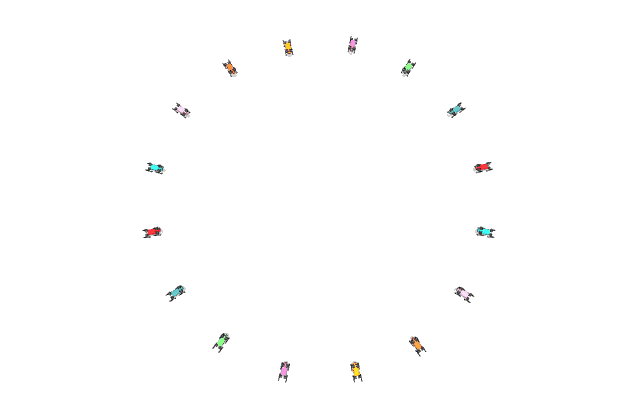
  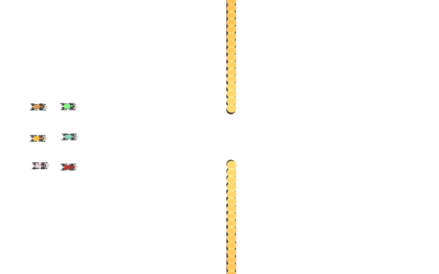
</p>

Multi-robot collision avoidance usually treats each robot as a point that can change its velocity at any
moment. A trotting quadruped cannot: how well it absorbs a new velocity command depends on **where in the
gait cycle** the change arrives. This repository measures that dependence for a Bezier-curve trot
controller on a simulated Unitree Go1 and uses it in a decentralized swarm:

- the swarm layer solves **ORCA one gait period ahead** (lookahead 0.36 s),
- a **phase-aware commander** releases each new command at the gait phase that a measured capability map
  predicts is least destabilizing,
- a **gait-aware slew limiter** shapes the change, and
- urgent conflicts (time to collision < 0.8 s, or < 1.5 s to a static obstacle) bypass the timing.

Every robot runs the same local rules; there is no central planner.

> **Paper:** *Gait-Phase-Aware Command Timing for Decentralized Quadruped Swarms*, Bishwaswarup Nayak
> (Indian Institute of Science), preprint, 2026. LaTeX source and figures are in [`paper/`](paper/).
> How to cite: [below](#citation).

## Results at a glance

Full system vs. the same stack without timing (reactive ORCA + slew limiter), 790 runs, paired by seed,
sign-flip permutation tests with Holm correction over 21 primary tests:

| | |
|---|---|
| Urgent avoidance events (crowded / obstructed scenarios) | **−22 to −39 %** |
| 99th-percentile body tilt | **−19 to −24 %** |
| Closest robot–robot distance in formations | **+4 to +8 %** (2–5 cm) |
| Falls | **0** in 230 full-system runs (baseline: 2 in 170) |
| 53 m obstacle course, team of 6 | p99 tilt 7.95° → 6.68°, max tilt 18.3° → 13.7° |
| Significant after Holm | 15 of 21 tests, 13 in favour of the full system |

Prediction without phase timing gives no consistent benefit, so the timing is the active ingredient.
In sparse traffic (four-robot swap) the method costs more than it saves (urgent events +109 %).
Full tables: [`results/paper/paper_tables.md`](results/paper/paper_tables.md).

## Gallery

| Single robot: Bezier trot | Obstacle course, team of 6 |
|:---:|:---:|
| 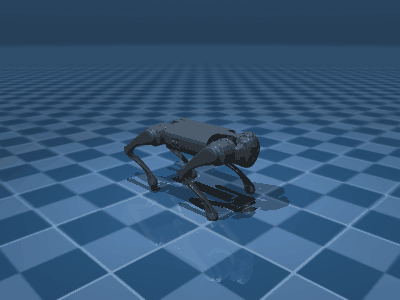 | 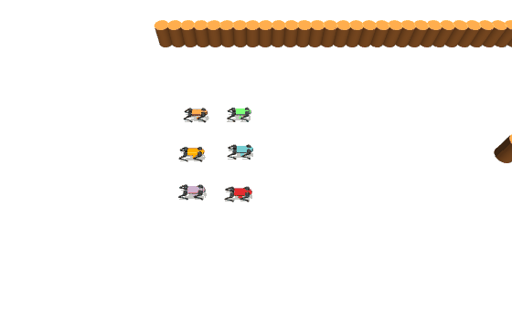 |

**Swarm paths** (full system, seed 0; one colour per robot, dots trace the trunk):

| 16-robot antipodal swap | 6-robot formation through a 1.9 m gate |
|:---:|:---:|
| 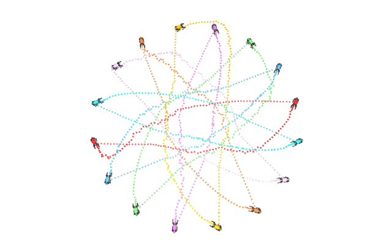 | 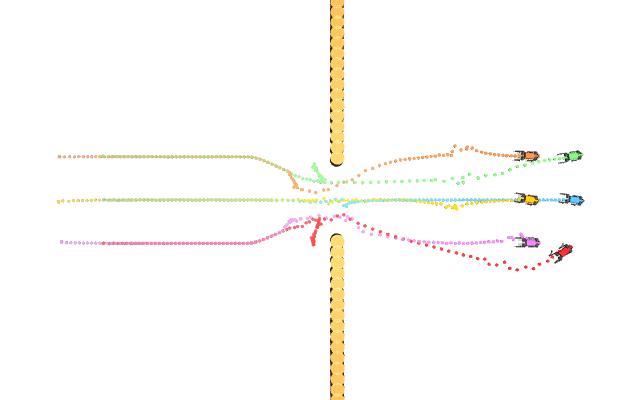 |

<p align="center">
  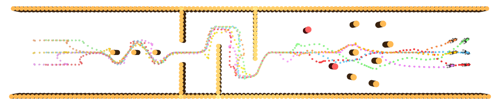<br>
  <em>Obstacle course (53 m): pole slalom, gate, chicane, two timed moving obstacles, pillar field.</em>
</p>

<p align="center">
  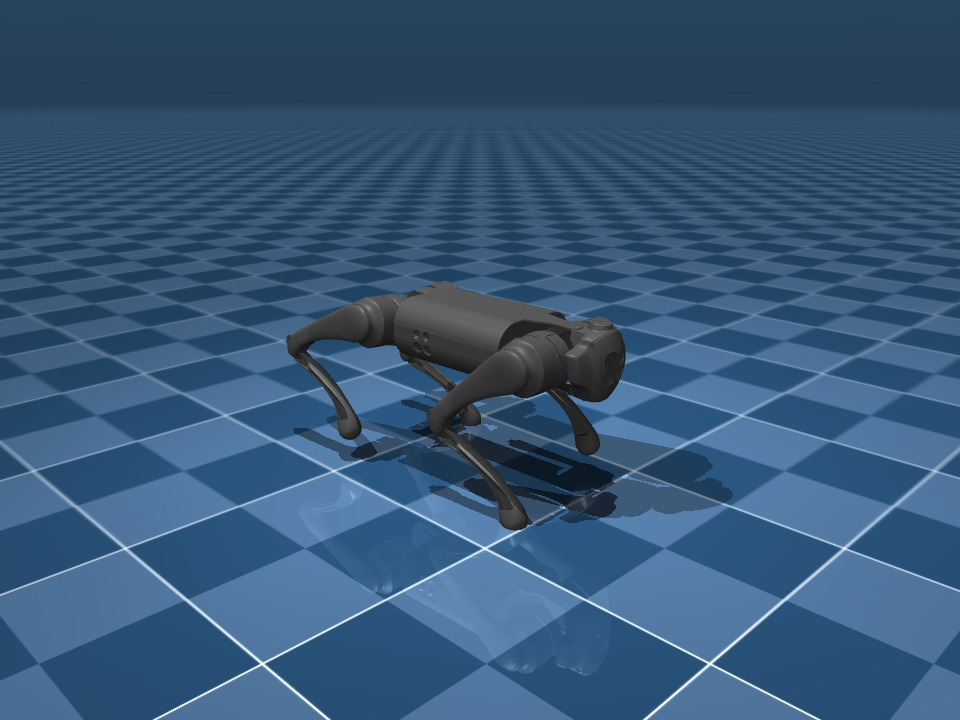
</p>

All media are rendered offscreen by [`scripts/make_media.py`](scripts/make_media.py) (about 15 min on a laptop).
To add your own (e.g. hardware photos or videos), drop the file in [`docs/media/`](docs/media/) and link it here:
``.

## Paper figures

<details open>
<summary><b>Fig. 1 – The gait phase matters</b></summary>

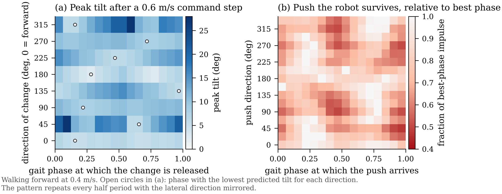

Walking at 0.4 m/s: (a) peak body tilt after a 0.6 m/s command step, by direction of the change and the gait
phase at which it is released; (b) largest survivable push, relative to the best phase for that direction.
</details>

<details>
<summary><b>Fig. 2 – Control stack</b></summary>

Drawn in TikZ inside the paper ([`paper/body.tex`](paper/body.tex)): predictive ORCA → phase-aware commander →
gait-aware slew limiter → Bezier trot controller, with the urgent bypass.
</details>

<details>
<summary><b>Fig. 3 – Primary results (full system vs. baseline)</b></summary>

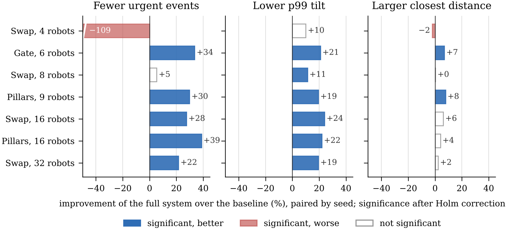
</details>

<details>
<summary><b>Fig. 4 – Ablation: which component does the work</b></summary>

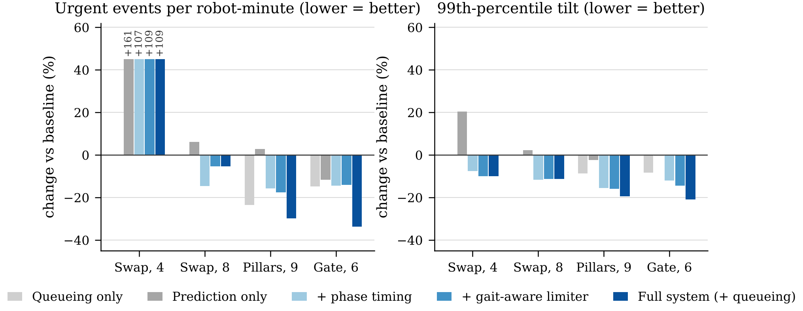
</details>

<details>
<summary><b>Fig. 5 – Lookahead</b></summary>

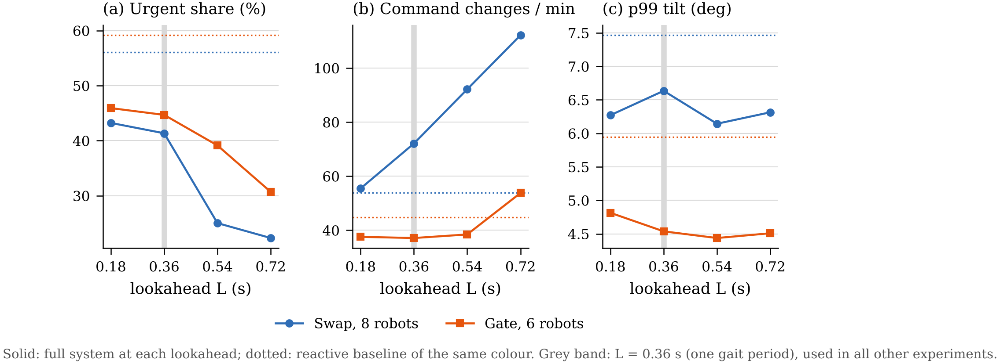

Solving ORCA one gait period ahead lowers the share of urgent commands from 56 % to 22–43 %.
</details>

<details>
<summary><b>Fig. 6 – Obstacle course paths</b></summary>

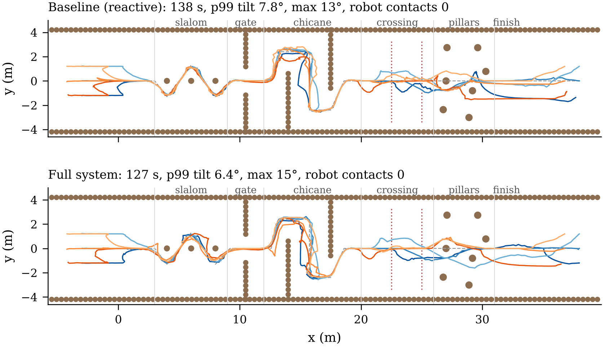

Pole slalom, gate, chicane, two timed moving obstacles and a pillar field (53 m), team of 6.
</details>

## Setup

```bash
git clone https://github.com/Bishwaswarup/robot.git && cd robot
git clone https://github.com/google-deepmind/mujoco_menagerie.git   # Go1 model (not included)
python -m venv .venv && source .venv/bin/activate
pip install -r requirements.txt
pytest                                                              # unit + physics tests
```

The model is looked up at `./mujoco_menagerie`; override with `MENAGERIE_PATH=/path/to/mujoco_menagerie`.
On macOS the interactive viewer needs `mjpython` (installed with `mujoco`); elsewhere use `python`.

## Quick start

```bash
mjpython examples/walk_demo.py                               # one robot, scripted walk
mjpython examples/swarm_demo.py --scenario formation6_gate   # swarm scenario in the viewer
mjpython examples/course_demo.py --team 6                    # obstacle course
python scripts/make_media.py                                 # README GIFs/PNGs (headless Linux: MUJOCO_GL=osmesa)
```

```python
import mujoco
from go1_bezier import load_team, Go1BezierController

model, data = load_team([(0, 0, 0), (1.5, 0, 0)])            # (x, y, yaw) per robot
robots = [Go1BezierController(model, data, prefix=f"go1_{i}/") for i in range(2)]
robots[0].set_command(0.4, 0.0, 0.3)    # vx, vy (m/s), wz (rad/s), body frame
for _ in range(1000):
    for r in robots:
        r.step()
    mujoco.mj_step(model, data)
print(robots[0].phase)                  # gait phase in [0, 1), used by the swarm layer
```

## Reproduce the paper

| Step | Command | Output |
|---|---|---|
| 1. Phase dependence (pilot) | `python scripts/pilot_phase.py` | `results/pilot*` |
| 2. Capability map | `python scripts/capability_map.py` | `data/capability_map_bezier.npz` |
| 3. Push envelope | `python scripts/push_envelope.py` | `data/push_envelope_bezier.npz` |
| 4. Gait stability | `python scripts/floquet.py` | Floquet multipliers |
| 5. Swarm experiments | `python scripts/paper_runs.py --robust` | `results/paper/{main,lookahead,scaling,obstacles}_robust/` |
| 6. Obstacle course | `python scripts/course_eval.py --seeds 20 --speed 0.45 --robust` | `results/course/` |
| 7. Tables | `python scripts/paper_tables.py` | `results/paper/paper_tables.md`, `primary_tests.csv` |
| 8. Figures | `python scripts/paper_figures.py` | `paper/figures/*.pdf, *.png` |
| 9. Media | `python scripts/make_media.py` | `docs/media/*.gif, *.png` |

The maps in `data/` and the raw results in `results/` are included, so steps 7–9 run without re-simulating.
Step 5 takes several hours on one machine (`--quick` ≈ 15 min). Swarm configurations are written
`layer:strategy[:q]`; the full system is `predictive:phase+gaslc_equal:q`, the baseline `reactive:limiter`.

<details>
<summary>All scripts</summary>

| Command | What it does |
|---|---|
| `python examples/record_video.py` | Render the walk to MP4 without a window |
| `python scripts/test_walk.py` | Command vs. measured velocity table |
| `python scripts/stress_test.py` | Random abrupt commands, counts falls |
| `python scripts/height_range.py` | Min/max stand height and walkable heights |
| `python scripts/floquet.py` | Gait stability: Poincaré map, Floquet multipliers |
| `python scripts/pilot_phase.py` | Does the disturbance response depend on gait phase? (`--quick` ≈ 1 min) |
| `python scripts/capability_map.py` | Build and validate the capability map; phase-aware timing analysis |
| `python scripts/push_envelope.py` | Push-capability envelope J_max(direction, phase, speed) by bisection |
| `python scripts/commander_eval.py` | Closed-loop test of phase-aware timing vs. immediate release / slew limiter |
| `python scripts/swarm_eval.py` | Swarm scenarios × configurations (`--robust` for the final safety stack) |
| `python scripts/swarm_stats.py <csv>` | Paired statistics (bootstrap CI, permutation p) vs. baseline |
| `python scripts/course_eval.py` | Obstacle course, team of 1 and 6, section times |
| `python scripts/paper_runs.py` | All paper swarm experiments (`--suites`, `--quick`, `--robust`) |
| `python scripts/paper_tables.py` | Holm-corrected tables from the final runs |
| `python scripts/paper_figures.py` | Paper figures |
| `python scripts/make_media.py` | README GIFs and stills (`--only trot,swap16,gate,course`) |
| `mjpython examples/trick_demo.py` | Height range, lie down/stand up, sit and wave |

</details>

## Repository layout

```
go1_bezier/        controller and swarm package
  kinematics.py      Go1 leg IK/FK
  gait.py            phase-clocked Bezier trot
  controller.py      velocity interface: slew limit, PI velocity loop, Raibert foot placement
  capability.py      CapabilityMap (tilt/fall vs. phase) and PushEnvelope
  commander.py       PhaseAwareCommander: releases large changes at the best phase
  gasl.py            gait-aware slew limiter + strategy names
  orca.py            ORCA (port of RVO2's linear programs) with static disc obstacles
  swarm.py           SwarmAgent: predictive ORCA, keep-right, turn gate, local-minimum escape,
                     FormationPlan, queueing responsibility
  scenarios.py       swap4/8/16/32, formation9/16 through pillars, formation6 through a gate
  course.py          53 m obstacle course, PathPlan, timed moving obstacles
  poses.py, tricks.py  static body poses, sit/wave routine
data/              capability map and push envelope (.npz)
examples/          viewer demos, video recording
scripts/           experiments, statistics, tables, figures, media
results/           raw CSVs of the paper runs
paper/             LaTeX source (main.tex, Springer main_sn.tex), figures, bibliography
docs/              research notes, docs/media (README GIFs and images)
tests/             pytest
```

## Low-level controller

- Tracks within ~0.02 of the command: forward 0.3/0.6 m/s, backward −0.3 m/s, lateral 0.25 m/s, yaw 0.8 rad/s.
- Random abrupt commands (vx −0.4…0.8, vy ±0.3, wz ±1.0, changed every 0.5–2 s): 0 falls in 4 min.
- Trunk height 0.12–0.38 m standing; walks at hip-to-foot 0.16–0.34 m.
- Speed on one CPU core: 1 robot ≈ 7× real time, 16 ≈ 1×, 64 ≈ 0.25×.

Defaults: period 0.36 s, duty 0.5, clearance 0.07 m, stand 0.27 m, foot friction 0.9, k_i 1.5, k_raibert 0.1,
slew limit (1.5 m/s², 1.0 m/s², 3 rad/s²).

## Limitations

Simulation only (MuJoCo, flat ground, perfect state estimation); one gait (trot) and one controller; the
capability map is specific to this controller. Hardware validation is future work.

## Citation

If you use this code, please cite the paper (GitHub's **"Cite this repository"** button reads
[`CITATION.cff`](CITATION.cff)):

```bibtex
@misc{nayak2026gaitphase,
  author = {Nayak, Bishwaswarup},
  title  = {Gait-Phase-Aware Command Timing for Decentralized Quadruped Swarms},
  year   = {2026},
  note   = {Preprint},
  url    = {https://github.com/Bishwaswarup/robot}
}
```

## License and credits

MIT, see [LICENSE](LICENSE). Third-party components ([THIRD_PARTY_NOTICES.md](THIRD_PARTY_NOTICES.md)):
Bezier swing curve from spot_mini_mini (MIT); Go1 model from MuJoCo Menagerie (BSD-3, Unitree Robotics).
